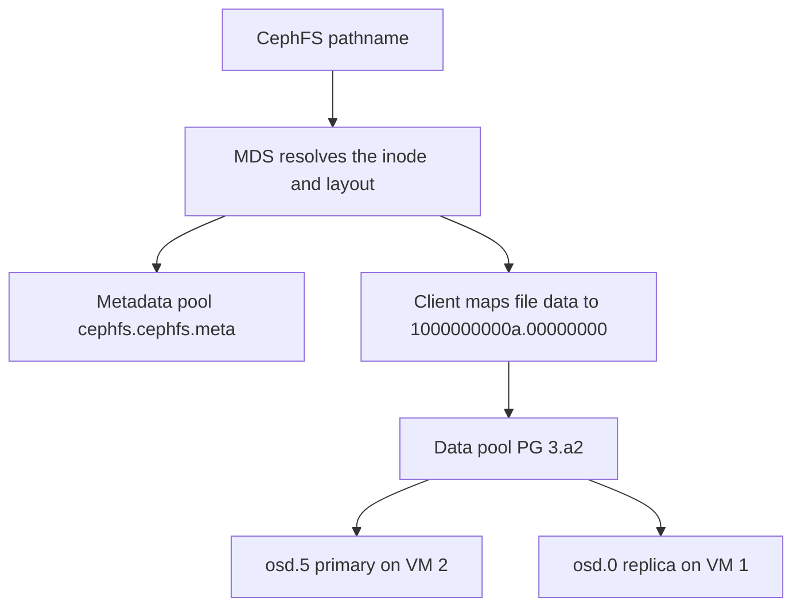

# Ceph experiments

Lab notes for a Ceph Squid cluster running on one Linux laptop and two Ubuntu VMs. The experiments cover cluster health, native RADOS, CephFS, and S3 through RADOS Gateway.

## 20 November 2026 — Cluster baseline and monitor disk space

### Observed baseline

The cephadm container reported Ceph Squid `v19.2.3`. The laptop and both VMs each ran a monitor. All three monitors were in quorum. The manager and CephFS metadata server each had one standby.

Each Ubuntu VM has three virtual disks. One holds the operating system and two are dedicated to Ceph, with one OSD per Ceph disk.

| Storage host | OS disks | Dedicated Ceph disks | OSDs observed up and in |
| --- | ---: | ---: | --- |
| VM 1 | 1 | 2 | `osd.0`, `osd.1` |
| VM 2 | 1 | 2 | `osd.4`, `osd.5` |

Disk layout confirmed by the lab operator. OSD state comes from the cluster baseline.

All 305 placement groups were `active+clean` across four pools. Ceph reported approximately 80 GiB of raw OSD capacity available. The two VMs share a single physical laptop, so this lab has two logical OSD hosts in one physical failure domain.

### Monitor warning and resolution

The baseline showed `HEALTH_WARN` with `MON_DISK_LOW` on VM 2. Ceph reported 23% free on the filesystem containing that monitor’s database. Guest checks showed the database directory on `/`, the ext4 filesystem backed by the Ubuntu LVM root volume. Before expansion, `/` showed approximately 14 GiB total, 9.8 GiB used, and 3.2 GiB available. `/var` accounted for about 4.5 GiB.

After a reported 14 GB expansion of the VM system storage, `ceph health detail` returned **`HEALTH_OK`**. The final ext4 filesystem size was not captured in the supplied evidence.

The monitor database on VM 2 uses the OS disk. The raw OSD capacity describes the dedicated Ceph disks across both VMs. [Ceph Squid health checks](https://docs.ceph.com/en/squid/rados/operations/health-checks/#mon-disk-low)

Commands used to capture the baseline on the administration host:

```bash
sudo cephadm shell -- ceph -s
sudo cephadm shell -- ceph health detail
sudo cephadm shell -- ceph osd tree
sudo cephadm shell -- ceph orch host ls
```

On the affected VM, use the local monitor directory to identify the filesystem that backs it:

```bash
# Set this to the monitor data directory on the affected VM.
mon_dir=/var/lib/ceph/CLUSTER_FSID/mon.MONITOR_ID
sudo df -hT "$mon_dir"
sudo findmnt -T "$mon_dir"
```

Source for the observed results: terminal output from the lab run on 20 November 2026.

### Native RADOS across the two VMs

**Run 02:** `cross-vm-run02` in `thesis-rados-lab`. The cross-VM read and overwrite checks passed. VM 2 verified version 1 with `cmp`. VM 1 then verified the exact version 2 bytes written by VM 2. Deletion and the subsequent lookup remain pending.

At OSD map epoch `263`, the object mapped to placement group `5.9`. The up and acting sets both listed `[5,1]`. `osd.5` on VM 2 was the primary and `osd.1` on VM 1 was the replica.

```text
osdmap e263 pool 'thesis-rados-lab' (5) object 'cross-vm-run02' -> pg 5.dcadc69 (5.9) -> up ([5,1], p5) acting ([5,1], p5)
```

**Previous attempt:** VM 2 retrieved the version 1 payload written on VM 1 from `cross-vm-run01`. VM 2 then ran `rados put` for version 2 and the terminal showed no write error. The return read, placement and deletion remain unverified for that attempt.

An earlier read from the administration host stopped because the test configuration file was unavailable inside the Cephadm container. The read from VM 2 succeeded with the local lab directory mounted into the container.

1. Reuse the dedicated replicated test pool and pool-scoped CephX identity on both VMs. Confirm the CRUSH rule selects different hosts and the test pool’s placement groups are `active+clean`.
2. Write a synthetic payload with `rados put` on VM 1. Retrieve it with `rados get` on VM 2 and check the bytes. Overwrite it on VM 2 and verify the replacement bytes on VM 1.
3. While the object exists, run `ceph osd map POOL OBJECT`. Record the placement group and acting OSD IDs. Use `ceph osd tree` to verify which host serves each copy.
4. Remove the test object with `rados rm`. Confirm a fresh `rados stat` on the other VM reports that the object is absent.

A verified cross-VM read demonstrates that both clients reach the same object. The acting set and OSD tree show where the object’s placement group is served. [RADOS CLI](https://docs.ceph.com/en/squid/man/8/rados/) · [Ceph architecture](https://docs.ceph.com/en/squid/architecture/)

## 20 November 2026 — RADOS Gateway startup

Cephadm initially reported no RGW service. A single `rgw.thesis-lab` daemon was deployed on VM 2 using the Beast frontend and HTTP port `8080`, bound to the private VM network. The daemon reported `running` on Ceph Squid 19.2.3.

Before deployment, VM 2 reported 3.8 GiB total guest RAM and 2.6 GiB available. The first Cephadm status sample reported `72.0M` memory use for the gateway. These are startup observations. Sustained load and peak memory usage are pending measurement.

An unsigned `GET /` returned `HTTP/1.1 200 OK` with the Ceph Object Gateway server header, S3 `ListAllMyBucketsResult` XML, and an empty bucket list for owner `anonymous`. That establishes that the HTTP frontend is reachable and processed the request as anonymous.

The signed S3 round trip passed using curl with AWS Signature Version 4 and a dedicated RGW test user.

| Check | Result |
| --- | --- |
| Create bucket | HTTP 200 |
| Upload object | HTTP 200 |
| Download object | HTTP 200 |
| Compare original and downloaded payload with `cmp` | Exact byte match |
| Delete object | HTTP 204 |
| Delete bucket | HTTP 204 |

Source: lab terminal output from 20 November 2026. [Ceph Squid RGW deployment](https://docs.ceph.com/en/squid/cephadm/services/rgw/) · [S3 authentication](https://docs.ceph.com/en/squid/radosgw/s3/authentication/)

## 20 November 2026 — Dashboard management API

`ceph mgr services` advertised an HTTPS Dashboard endpoint on the active manager on VM 1. After HTTPS server verification by public-key pin and Dashboard authentication, the API returned these results:

| Endpoint | Observed result |
| --- | --- |
| `GET /api/health/minimal` | `HEALTH_OK` |
| `GET /api/osd` | Four OSD entries |

This check demonstrates authenticated cluster monitoring through the manager API. The preceding S3 experiment demonstrates object I/O through RADOS Gateway.

Source: lab terminal output from 20 November 2026. [Ceph Squid REST API](https://docs.ceph.com/en/squid/mgr/ceph_api/)

## 20 November 2026 — CephFS file to RADOS object

The CephFS service showed one active MDS and one standby. The administration host restored its kernel mount of the scoped CephFS subdirectory before creating the test file.

| Observation | Value |
| --- | --- |
| Filesystem metadata pool | `cephfs.cephfs.meta` |
| File data pool | `cephfs.cephfs.data` |
| File size and inode | 22 bytes, inode `1099511627786` |
| File layout | `stripe_unit=4194304 stripe_count=1 object_size=4194304` |
| First RADOS data object | `1000000000a.00000000` |
| RADOS stat result | 22 bytes |
| Placement group and OSD map epoch | `3.a2`, epoch `373` |
| Up and acting sets | `[5,0]`, primary `osd.5` on VM 2, replica `osd.0` on VM 1 |



`stat` supplied the inode and byte count. The `ceph.file.layout` extended attribute identified the pool and layout. The initial RADOS object name combines the hexadecimal inode with object index zero. `rados stat` verified the object existed with the same byte count. `ceph osd map` showed the placement group and its acting OSDs, and the baseline OSD tree identified their hosts.

Source: lab terminal output from 20 November 2026. [CephFS architecture](https://docs.ceph.com/en/squid/cephfs/) · [CephFS I/O path](https://docs.ceph.com/en/squid/cephfs/cephfs-io-path/) · [CephFS layouts](https://docs.ceph.com/en/squid/cephfs/file-layouts/)

## 20 November 2026 — OSD storage backend

All four OSDs reported BlueStore in `ceph osd metadata`.

| Storage host | OSDs | Backend |
| --- | --- | --- |
| VM 1 | `osd.0`, `osd.1` | BlueStore |
| VM 2 | `osd.4`, `osd.5` | BlueStore |

On VM 2, `osd.5` had a `block` symlink to an LVM logical volume. The directory inspection showed no separate `block.db` or `block.wal` link, so its BlueStore database and write-ahead log share its main block device. This inspection covered `osd.5`, the primary observed in both placement traces.

BlueStore manages object data directly on its block device and uses RocksDB, supported by BlueFS, for OSD-local metadata. CephFS namespace metadata lives in a separate RADOS pool and serves a different role. FileStore used a host filesystem for object data. Its support ended with Reef.

Source: lab terminal output from 20 November 2026. [BlueStore devices](https://docs.ceph.com/en/squid/rados/configuration/bluestore-config-ref/) · [BlueStore migration](https://docs.ceph.com/en/squid/rados/operations/bluestore-migration/)

## 20 November 2026 — Idle memory baseline

Measurements were taken without a deliberate Ceph workload while normal desktop applications were open on the host.

| Node | Total RAM | Available RAM | Swap used / total |
| --- | ---: | ---: | ---: |
| Mint host | 23 GiB | 8.9 GiB | 1.8 GiB / 2.0 GiB |
| VM 1 | 3.8 GiB | 1.6 GiB | 0 B / no swap configured |
| VM 2 | 3.8 GiB | 2.4 GiB | 268 KiB / 2.8 GiB |

Memory PSI `some` and `full` averages displayed `0.00` on all three hosts. The four interval readings after the first `vmstat` report had `si=0` and `so=0` on each host. The host retained 1.8 GiB in swap, with no active swap traffic in the sampled intervals. The two QEMU processes showed about 3.9 GiB RSS each and topped the host process list. Browser processes were the next largest individual host entries. Guest memory is represented within the host’s VM processes, and RSS values may include shared pages.

| Cephadm observation | Reported value |
| --- | --- |
| Largest Ceph daemon in `MEM USE` | Active manager on VM 1, `696M` |
| Monitor `MEM USE` | `435M` to `453M` |
| OSD `MEM USE` | `112M` to `118M` per daemon |
| RGW `MEM USE` | `128M` |
| OSD `MEM LIM` as displayed | `4096M` each on VM 1 and `1589M` each on VM 2 |

`orch ps` reported its daemon data was about eight minutes old. The next measurement should capture memory stalls, swap rates and daemon usage during a bounded workload. Check the effective OSD memory targets before deciding whether to tune them.

Source: lab terminal output from 20 November 2026. [Linux memory pressure](https://docs.kernel.org/accounting/psi.html) · [Ceph Squid OSD memory tuning](https://docs.ceph.com/en/squid/cephadm/services/osd/#automatically-tuning-osd-memory)
